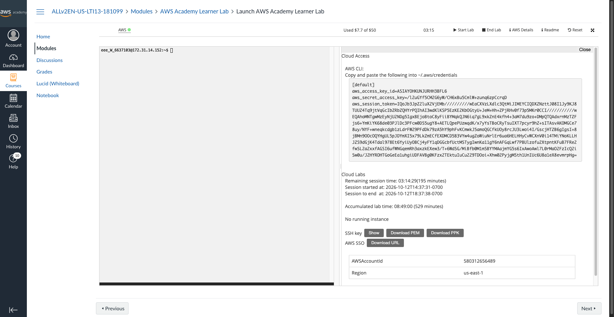

# Diferentes Paradigmas de Interação em Aplicações Distribuídas com ZeroMQ

Implementação e teste dos **três paradigmas de interação** do middleware de
mensageria **ZeroMQ** (Figs. 4.21, 4.22 e 4.23 do livro de Maarten van Steen),
estendendo os exemplos mínimos do livro para **aplicações de verdade** e rodando
tudo em **máquinas diferentes na AWS (EC2)**.

Diferente de um RPC, no ZeroMQ não existe "chamada de função remota": o
programador escolhe um **padrão de sockets** (par de tipos de socket) que define
*como* as partes conversam — requisição/resposta, publicação/assinatura ou
distribuição de tarefas. Este trabalho exercita os três:

| Figura (livro) | Aplicação (este repo) | Sockets | Paradigma |
|---|---|---|---|
| 4.21 | `app/reqrep` — key-value store | `REQ` / `REP` | Request-Reply (cliente/servidor, síncrono em *lockstep*) |
| 4.22 | `app/pubsub` — estação de sensores | `PUB` / `SUB` | Publish-Subscribe (1 → N, filtragem por tópico) |
| 4.23 | `app/pipeline` — ventilator/workers/sink | `PUSH` / `PULL` | Pipeline (distribuição paralela de tarefas) |

Toda a infraestrutura é **código**: o **Terraform** cria as instâncias EC2 e o
**Ansible** instala o `pyzmq` e publica as aplicações. O objetivo é ser
**plug-and-play**: `make deploy` sobe tudo e imprime os comandos prontos para
copiar e colar; `make down` destrói tudo (importante para não gastar crédito).

> A pasta `code-Chap04-Python3/` é apenas o material de referência fornecido pelo
> professor e **não faz parte** do projeto (está no `.gitignore`).

---

## Estrutura do repositório

```
.
├── app/                         # as 3 aplicações ZeroMQ (só Python + pyzmq)
│   ├── reqrep/                  # REQ/REP  — key-value store
│   │   ├── constCS.py           #   HOST/BIND/PORT (HOST vem de ZMQ_HOST)
│   │   ├── server.py            #   servidor (REP)
│   │   └── client.py            #   cliente  (REQ), interativo ou "um tiro"
│   ├── pubsub/                  # PUB/SUB  — estação de sensores
│   │   ├── constPS.py
│   │   ├── publisher.py         #   publica TEMP/HUMID/WIND (PUB)
│   │   └── subscriber.py        #   assina os tópicos pedidos (SUB)
│   └── pipeline/                # PUSH/PULL — pipeline paralelo
│       ├── constPipe.py
│       ├── ventilator.py        #   distribui as tarefas (PUSH)
│       ├── worker.py            #   processa em paralelo (PULL + PUSH)
│       └── sink.py              #   coleta e agrega os resultados (PULL)
├── infra/
│   ├── terraform/               # cria as EC2 (Amazon Linux 2023, us-east-1)
│   │   ├── versions.tf
│   │   ├── variables.tf
│   │   ├── main.tf
│   │   ├── outputs.tf
│   │   └── inventory.tftpl       # modelo do inventário do Ansible
│   └── ansible/
│       ├── ansible.cfg
│       └── playbook.yml          # instala python/pyzmq e publica o app/
├── scripts/
│   ├── demo-local.sh             # roda os 3 paradigmas em localhost (sem AWS)
│   └── print-commands.sh         # imprime os comandos prontos para a AWS
├── Makefile                      # setup / demo-local / deploy / down ...
└── requirements.txt              # pyzmq
```

---

## Teste rápido local (sem AWS)

Para ver os três paradigmas funcionando na sua máquina antes de ir para a nuvem:

```bash
make setup        # cria o venv e instala o pyzmq
make demo-local   # roda REQ/REP, PUB/SUB e o pipeline em localhost
```

Saída esperada (resumida):

```
################ 1) REQ/REP - key-value store ################
SET nome andre -> OK
GET nome -> OK andre
INCR visitas -> OK 1
INCR visitas -> OK 2
KEYS -> DATA 2
nome
visitas
GET fantasma -> ERR chave inexistente

################ 2) PUB/SUB - filtragem por topico ################
-- subscriber assinando apenas TEMP e WIND (NAO deve aparecer HUMID):
   TEMP #2 19:07:25 24.9
   WIND #2 19:07:25 56.9
   ...

################ 3) PIPELINE - ventilator/workers/sink ################
Coletando 60 resultados...
Concluido em 0.20s
Soma de todos os resultados: 4741712
Tarefas por worker:
  worker A: 30 tarefas
  worker B: 30 tarefas
```

---

## Rodando na AWS (máquinas diferentes)

### Pré-requisitos (ferramentas)

Instale na sua máquina (uma vez). No macOS, via Homebrew:

```bash
brew tap hashicorp/tap
brew install hashicorp/tap/terraform ansible awscli
```

- **Terraform** (`>= 1.5`) — <https://developer.hashicorp.com/terraform/install>
- **Ansible** — `pip install ansible` ou `brew install ansible`
- **AWS CLI** — só para guardar as credenciais; o Terraform as lê de `~/.aws`.

### Credenciais AWS — AWS Academy *Learner Lab* (vocareum)

Este projeto foi feito e testado na conta de estudante da **AWS Academy
(Learner Lab)**. Nela **você NÃO cria usuário IAM** nem usa `aws configure`
(a conta bloqueia `iam:CreateUser` de propósito, e as credenciais têm um
*session token*). Em vez disso, use as **credenciais temporárias** que o próprio
laboratório fornece:

1. Abra o laboratório e clique em **Start Lab**; espere a bolinha ficar **verde**.
2. No topo, clique em **AWS Details** (ou **"AWS CLI: Show"**).
3. Copie o bloco de credenciais exibido — ele já vem no formato do arquivo
   `~/.aws/credentials`, com três linhas:

   ```ini
   [default]
   aws_access_key_id=ASIA....................
   aws_secret_access_key=....................................
   aws_session_token=............(bem longo)............
   ```

4. Cole esse bloco em **`~/.aws/credentials`** (crie o arquivo se não existir).
5. Crie **`~/.aws/config`** com a região:

   ```ini
   [default]
   region=us-east-1
   output=json
   ```

6. Confira:

   ```bash
   aws sts get-caller-identity   # deve retornar um JSON com Account e Arn
   ```



No print acima, o botão **AWS Details** (canto superior direito) abre o painel
**Cloud Access**, onde fica o bloco do `~/.aws/credentials` (seção *AWS CLI*) e os
botões para baixar a chave `.pem`.

> **As credenciais do Learner Lab expiram** ao fim da sessão do laboratório
> (poucas horas) ou ao clicar em *End Lab*. As que aparecem neste print **já estão
> inválidas** — por isso não há problema em mostrá-las aqui. **Nunca** faça isso
> com credenciais de uma conta AWS real/permanente: lá elas não expiram sozinhas e
> seriam um vazamento de verdade.
>
> Se o `terraform`/`ssh` reclamar de *expired token* ou *InvalidClientTokenId*,
> reabra **AWS Details** e cole o bloco novo em `~/.aws/credentials`.

> **Em uma conta AWS comum** (não Learner Lab), o caminho é outro: crie um
> usuário IAM com a policy `AmazonEC2FullAccess`, gere uma *access key* (sem
> session token) e rode `aws configure` informando Access Key, Secret Key e a
> região `us-east-1`.

### Subir tudo

```bash
make init      # terraform init (só na primeira vez)
make deploy    # cria as 3 EC2, provisiona com Ansible e imprime os comandos
```

O `make deploy` faz, em ordem:

1. **`terraform apply`** — cria **3 instâncias** `t3.micro` com Amazon Linux 2023
   na `us-east-1` (1 **coordenador** + 2 **nós**), um *security group* liberando
   SSH e as portas `5555-5558`, e um par de chaves SSH salvo localmente
   (`infra/terraform/zmq-key.pem`). Também gera o inventário do Ansible.
2. **`ansible-playbook`** — em cada instância: instala Python 3 e `pyzmq` (em um
   *venv*), copia as aplicações para `~/zmq/app` e exporta `ZMQ_HOST` apontando
   para o **IP privado do coordenador** (assim os clientes/subscribers/workers já
   sabem onde achar o servidor, sem configurar nada na mão).
3. **`print-commands.sh`** — imprime os comandos prontos para copiar e colar.

> Quantidade de máquinas, região e tipo de instância são variáveis do Terraform:
> `terraform -chdir=infra/terraform apply -var instance_count=4 -var region=sa-east-1`.

### Entrar nas máquinas

Em cada instância, depois do SSH, ative o ambiente com o atalho `zmq`
(entra em `~/zmq` e ativa o *venv*; o `ZMQ_HOST` já está no ambiente):

```bash
make ssh-coordinator      # ou: ssh -i infra/terraform/zmq-key.pem ec2-user@<ip>
zmq                       # atalho para: cd ~/zmq && source .venv/bin/activate
```

### Destruir tudo (faça sempre ao terminar!)

```bash
make down
```

---

## Os três paradigmas, em detalhe

Rode `make commands` a qualquer momento para reimprimir os comandos com os IPs
reais. Abaixo, o que cada aplicação faz e o que esperar.

### 1. REQ/REP — key-value store (`app/reqrep`)

O exemplo do livro só devolvia a mensagem recebida com um `*` no final. Aqui o
servidor virou um **banco chave-valor em memória**, com estado **compartilhado
entre todos os clientes**. O `REQ`/`REP` é um diálogo em *lockstep*: cada
requisição do cliente tem **exatamente uma** resposta do servidor.

Protocolo (uma linha de texto por requisição):

| Comando | Resposta | O que faz |
|---|---|---|
| `SET <chave> <valor>` | `OK` | grava/atualiza a chave |
| `GET <chave>` | `OK <valor>` ou `ERR chave inexistente` | lê a chave |
| `DEL <chave>` | `OK` ou `ERR chave inexistente` | remove a chave |
| `INCR <chave>` | `OK <n>` | incrementa um contador (cria em 0) |
| `KEYS` | `DATA <n>` + `n` linhas | lista as chaves |
| `STOP` | `OK bye` | encerra o servidor |

**Servidor** (coordenador) e **cliente** (um nó):

```bash
# coordenador
zmq && python app/reqrep/server.py
# nó
zmq && python app/reqrep/client.py
> SET nome andre
OK
> INCR visitas
OK 1
> KEYS
DATA 2
nome
visitas
> QUIT
```

O cliente também aceita um comando único por argumento
(`python app/reqrep/client.py GET nome`), útil para scripts. Suba um segundo
cliente em outro nó e confira que ele enxerga as chaves gravadas pelo primeiro —
o estado vive no servidor.

### 2. PUB/SUB — estação de sensores (`app/pubsub`)

O exemplo do livro publicava apenas a hora no tópico `TIME`. Aqui o publisher
emite, a cada segundo, **três tópicos** de uma estação meteorológica fictícia,
com número de sequência e horário:

```
TEMP  #42 19:07:25 24.9
HUMID #42 19:07:25 58.5
WIND  #42 19:07:25 56.9
```

Cada subscriber escolhe **o que quer ouvir** pela linha de comando; o filtro é
aplicado pelo próprio socket `SUB` (por prefixo do tópico). O publisher não sabe
(nem precisa saber) quem está conectado — é um fluxo 1 → N.

```bash
# coordenador (publisher)
zmq && python app/pubsub/publisher.py

# nó 1: só temperatura e vento
zmq && python app/pubsub/subscriber.py TEMP WIND

# nó 2: curinga, recebe tudo
zmq && python app/pubsub/subscriber.py
```

O nó 1 **nunca** verá linhas `HUMID`; o nó 2 vê as três. Essa é a prova visual
da filtragem no lado do assinante.

### 3. PIPELINE — ventilator/workers/sink (`app/pipeline`)

O exemplo do livro tinha fonte → worker e o "trabalho" era um `sleep`. Aqui o
pipeline paralelo está **completo** e o trabalho é de CPU de verdade (soma dos
divisores de um número):

```
ventilator  --PUSH-->  workers (N)  --PUSH-->  sink
            round-robin            resultados
```

- O **ventilator** distribui N tarefas; o socket `PUSH` faz *round-robin* entre
  todos os workers conectados.
- Cada **worker** puxa uma tarefa (`PULL`), calcula e empurra o resultado para o
  sink (`PUSH`).
- O **sink** coleta os N resultados, soma tudo e mostra **quantas tarefas cada
  worker processou** — a evidência do balanceamento de carga.

Ordem de inicialização (o sink primeiro, o ventilator por último):

```bash
# coordenador, terminal A
zmq && python app/pipeline/sink.py

# nó 1 e nó 2 (um worker em cada)
zmq && python app/pipeline/worker.py A
zmq && python app/pipeline/worker.py B

# coordenador, terminal B (dê Enter quando os workers estiverem no ar)
zmq && python app/pipeline/ventilator.py 200
```

Saída do **sink**:

```
Coletando 200 resultados...
Concluido em 0.63s
Soma de todos os resultados: 16104988
Tarefas por worker:
  worker A: 101 tarefas
  worker B: 99 tarefas
```

Suba **mais workers** (em mais nós) e repita: a divisão das tarefas acompanha o
número de workers, mostrando a escalabilidade do padrão sem alterar o código.

---

## Problemas comuns

| Sintoma | Causa provável | Solução |
|---|---|---|
| Cliente/worker trava sem receber nada | `ZMQ_HOST` não aponta para o servidor | confira `echo $ZMQ_HOST`; reative com `zmq`; rode `make provision` de novo |
| `Connection refused` | servidor ainda não subiu ou porta bloqueada | suba o servidor antes; confira o *security group* (`5555-5558`) |
| Ventilator manda tudo para um worker só | lote disparado antes dos workers conectarem | suba os workers, **depois** dê Enter no ventilator (*slow joiner*) |
| `Permission denied (publickey)` no SSH | chave errada ou permissão | use `-i infra/terraform/zmq-key.pem` (o Terraform já cria com `chmod 400`) |
| Terraform não acha credenciais | AWS CLI não configurado | `aws configure` |
| Esqueci a infra ligada | — | **`make down`** destrói tudo |

---

## Discussão: três paradigmas, um mesmo middleware

O que torna este trabalho interessante não é cada aplicação isolada, mas o
**contraste entre os três estilos de interação**, todos construídos sobre o mesmo
ZeroMQ e com pouquíssimo código de rede escrito à mão. A escolha do paradigma não
é um detalhe de implementação: ela determina o **acoplamento** entre as partes,
no tempo e no espaço, e o formato natural da aplicação.

O **Request-Reply** (`REQ`/`REP`) é o mais parecido com o modelo cliente/servidor
clássico. A interação é síncrona e em *lockstep*: o cliente envia e fica
bloqueado até a resposta, e o servidor responde exatamente uma vez por
requisição. Isso dá um acoplamento forte no tempo — os dois lados precisam estar
vivos e se revezando — mas é perfeito para operações com retorno, como o
key-value store, em que cada comando precisa de uma confirmação. O preço é que um
cliente lento ou uma resposta perdida travam o diálogo daquele par.

O **Publish-Subscribe** (`PUB`/`SUB`) inverte a lógica: há desacoplamento no
espaço e no tempo. O publisher não conhece os assinantes, não sabe quantos são e
não espera por eles; apenas emite. Quem decide o que receber é o assinante, pela
assinatura de tópicos, e a filtragem acontece sem a aplicação se envolver. É o
padrão natural para disseminação de eventos e telemetria, como a estação de
sensores — um fluxo 1 → N em que novos consumidores entram e saem sem afetar a
fonte. Em troca, não há garantia nem confirmação de entrega: quem não estava
conectado simplesmente perde as mensagens daquele instante.

O **Pipeline** (`PUSH`/`PULL`) resolve um terceiro problema: paralelizar trabalho.
O ventilator distribui tarefas e o ZeroMQ faz o balanceamento *round-robin* entre
os workers conectados, sem o emissor precisar saber quantos são. É um fluxo N → M
voltado a vazão e escalabilidade: para processar mais rápido, basta subir mais
workers, sem tocar no código. O sink fecha o ciclo agregando os resultados. Aqui
o acoplamento é fraco e a ênfase é na divisão de carga, não na resposta
individual a cada requisição.

Os três paradigmas compartilham as mesmas vantagens do middleware de mensageria
sobre sockets TCP crus. O ZeroMQ entrega **enquadramento de mensagens** (cada
`send` corresponde a um `recv`, sem o programador inventar delimitadores ou
prefixos de tamanho), **filas e reconexão automáticas** (os sockets toleram que a
outra ponta ainda não esteja no ar, resolvendo o problema de ordem de
inicialização), e **independência de topologia** (o mesmo `worker.py` roda
idêntico com um ou com dez workers). Sobre TCP puro, cada um desses pontos — o
*framing*, o *buffering*, o balanceamento, a reconexão — teria de ser reescrito à
mão e em cada aplicação.

O custo é o de sempre em middleware: uma dependência externa (o runtime do
ZeroMQ), a necessidade de escolher o padrão de sockets certo para cada problema —
usar `REQ`/`REP` onde cabia `PUB`/`SUB` levaria a um acoplamento desnecessário — e
semânticas de entrega que variam conforme o padrão (o `PUB`/`SUB`, por exemplo,
descarta mensagens para quem não está conectado). O balanço, porém, é claramente
favorável: com um único middleware e três escolhas de socket, cobrimos três
formas bem distintas de estruturar uma aplicação distribuída — cliente/servidor,
disseminação de eventos e processamento paralelo — e cada aplicação ficou com o
tamanho da sua lógica de negócio, não da sua lógica de rede.
